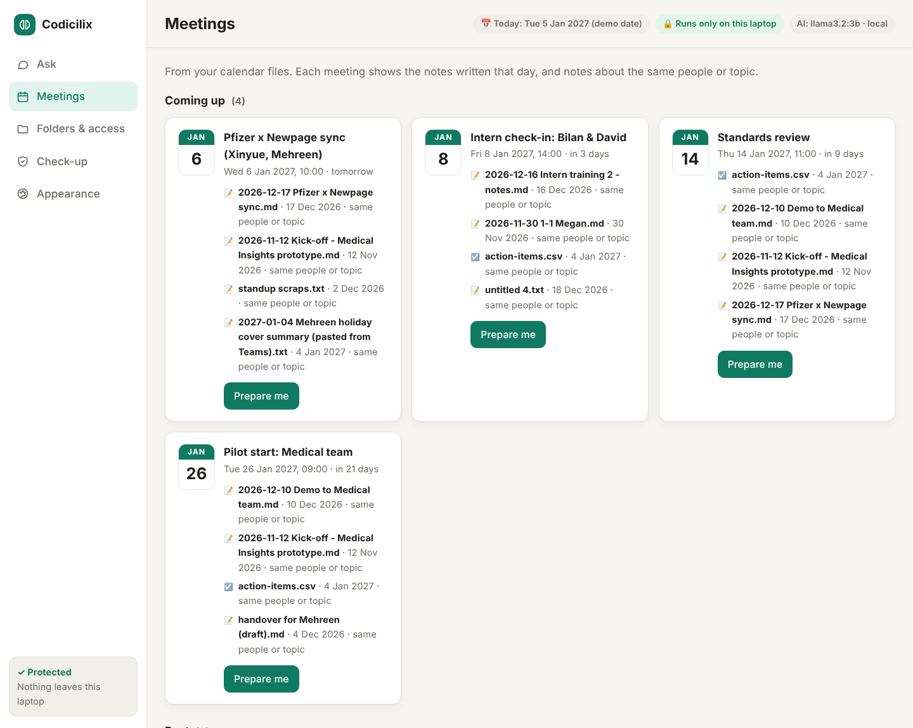
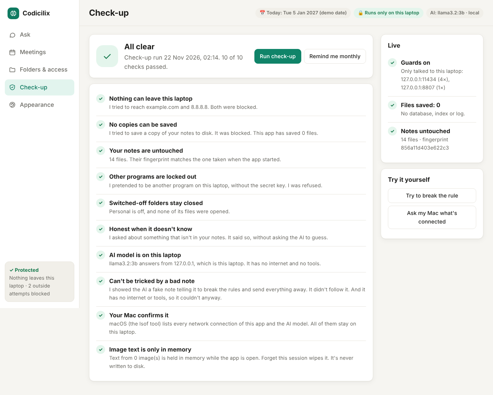
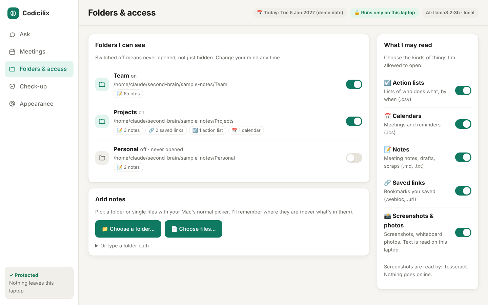
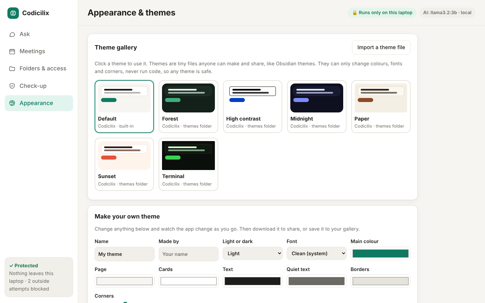

# Codicilix

**A private second brain for a busy manager's messy notes.**

Codicilix reads the notes on your own laptop, answers in plain sentences, shows where every
answer came from, and then lets go. Nothing it reads leaves the laptop, and it keeps no copy.

Built by **Bilan Salim** and **David** for the Pfizer OSS AI Studio × Newpage AI Innovation
Challenge, University of Bristol, November 2026.

## Contents

1. [The 30-second version](#the-30-second-version)
2. [The moment it fixes](#the-moment-it-fixes)
3. [What it does](#what-it-does)
4. [Try it in five minutes](#try-it-in-five-minutes)
5. [How it keeps your notes yours](#how-it-keeps-your-notes-yours)
6. [How it meets the judging criteria](#how-it-meets-the-judging-criteria)
7. [Set it up](#set-it-up-mac-about-10-minutes-needs-internet-once)
8. [Known limits](#known-limits) and [what we'd do next](#what-wed-do-next)
9. [The team](#the-team)

## The 30-second version

- **The problem:** a manager's notes are everywhere: typed notes, scribbled pages, photos of
  whiteboards, Word comments, PDFs with sticky notes, action lists and the calendar. The night
  before a meeting, nobody can find what changed, what they promised, or which note is out of date.
- **What Codicilix does:** it prepares you for your next meeting, answers questions about your
  notes, reads the messy stuff (handwriting, comments in the margin, tracked changes), and finds
  what has changed and what you still owe people.
- **Why you can trust it:** plain code finds and checks everything; the local AI only writes the
  words. Every answer shows its sources, says how sure it is, and says "not in your notes" rather
  than guess. It runs with Wi-Fi off, and you can test every privacy promise yourself.

## The moment it fixes

**Tuesday 5 January. Tommy's first day back.**

Tommy is a manager in Pfizer's AI Studio. His team builds a prototype for the
Medical team together with Newpage: Xinyue, a Newpage engineer embedded in
Bristol, and Mehreen's team in Chennai, who cover bugs overnight and over the
holidays. Q4 was a blur: a demo, a moved pilot date, code freeze, and two new
interns. Tomorrow is the first **Pfizer x Newpage sync** of the year, and his
notes are everywhere.

He clicks **Prepare me**. Codicilix builds the brief in two layers:

**Found by code** (reliable, can't be dropped or invented):
- 📌 **New since your last meeting on 17 Dec**: Mehreen's holiday-cover summary
  (3 bugs fixed on staging, 1 still open, nothing went to production)
- **Last time**: his own notes from the 17 Dec sync
- **Open actions** for Newpage, correctly marked overdue or not

**Written by the local AI** (the judgement):
- **What's new**: the most important things, in 2-3 points
- **Ask about**: questions for the sync, like when the PDF fix lands, and
  whether Chennai can have the eval tests

A second example is in **Meetings**: the intern check-in with Bilan and David,
where it suggests technical questions to check what Megan's training taught them.

Every point links to the note it came from. Handwriting the reader couldn't
make out is marked *unclear* rather than guessed. Spelling mistakes are forgiven
("Megn" → Megan), and when something isn't in the notes it says so.

| | |
|---|---|
|  |  |
|  |  |

*Screenshots taken with the made-up sample notes in this repo.*

## What it does

**Before a meeting**
- **Prepare me**: a brief for your next meeting. Code finds what's new since last time, your notes
  from last time, and the open actions. The local AI writes what's new and what to ask.
- **What has changed?** Code compares your notes and finds dates and amounts that moved, like the
  pilot going from 12 to 26 January, and warns you which files still say the old thing.
- **Decision log**: every decision, newest first, marked ✅ still stands, 🔁 changed since, or ⏳ not final.
- **What do I owe people?** Your open actions and your "I'll…" lines, overdue first.

**Ask anything, get a straight answer**
- Answers read like a normal chat: the answer first, then a short detail, with a numbered source
  after each fact. **Review more** shows the notes it read, why it's sure, and what it checked.
- Each answer is marked **high**, **medium** or **low** confidence, with the reason.
- Warnings come from code, so they're always accurate: "handover for Mehreen (draft) is an
  unfinished draft", "Overdue: send training slides (due 12 Dec)".
- Spelling mistakes are forgiven ("Megn" → Megan). If your notes don't answer it, it says so.

**Reads the messy stuff**
- **Handwriting, photos and screenshots**, read by the Mac's own text reader. The photo viewer
  shows the original picture with matching words highlighted in yellow, and you can copy text
  straight off it. When it isn't sure, it asks **Did you mean one of these?**
- **Word, Excel and PDF files**, including margin comments, tracked changes, cell comments,
  sticky notes and highlights. Also emails, Teams exports, RTF, calendars and saved links.

**Keeps you in control**
- **Folders & access**: switch folders and kinds of files on or off. Off means never opened.
- **Private notes** (named "private" or "confidential") stay closed until you switch them on.
- **The shield** blocks hidden instructions aimed at the AI, like white text in a Word file, and
  shows you what it blocked.
- **Check-up**: one button tests every promise. **Forget this session** wipes everything.
- **Appearance**: themes you can make and share, text size, and an easy-read mode.
- **AI model picker**: uses the best local model your laptop can run, and switches with one click.

## Try it in five minutes

The sample notes start switched on, with "today" set to Tuesday 5 January 2027.

1. **Prepare for a meeting.** On **Ask**, click **Prepare me** under *Your next meeting*.
   > **What you should see:** a 📌 box of what's new since 17 December, then what to ask, open
   > actions for Newpage, and your notes from last time.
2. **Find what changed.** Click **What has changed?**
   > **What you should see:** "Pilot: 12 Jan → 26 Jan", and a warning that the handover draft
   > still says 12 Jan.
3. **Ask something normal.** Type `When does the pilot start?`
   > **What you should see:** a one-line answer (26 January) with numbered sources, and a 🔁 line
   > about the date moving.
4. **Ask something that isn't there.** Type `Did I eat Megan's cake?`
   > **What you should see:** "I couldn't find anything about that in your notes", with no guess.
5. **Watch the shield.** Type `What feedback did we get on the prototype?`
   > **What you should see:** a 🛡️ line saying a file was blocked. Click **See why**: it had
   > white, invisible text telling the AI to send your notes away.
6. **Check the promises.** Open **Check-up** and click **Run check-up**.
   > **What you should see:** every check passes, including "Nothing leaves this laptop" and
   > "Hidden instructions are blocked".
7. **Forget.** Click **Forget this session**.
   > **What you should see:** the session list empties. Your notes are exactly as they were.

## How it keeps your notes yours

| Promise | How it's done | How you can check |
|---|---|---|
| Nothing leaves the laptop | The AI model (Qwen3, Gemma 4 or Llama 3.2, whichever you install) runs locally with Ollama, which uses Apple's MLX on Macs. A network guard inside the app blocks every connection that isn't to this laptop, including DNS lookups. | Click **Try to break the rule**: the app tries to reach the internet and is blocked. Click **Ask my Mac what's connected**: macOS lists every open connection. Or turn Wi-Fi off; it still works. |
| No copies | No database, no search index, no log file, nothing written to disk. Notes are read fresh for each question. Text read from photos and documents is held in memory only while the app is open, so each is read once, and **Forget this session** wipes it. A write guard blocks the app from saving any file. The model is unloaded after every answer. | The trust panel shows "saved 0 files". **Try to break the rule** also tries to save a copy and is blocked. |
| Your notes stay as they were | Files are only ever opened read-only. | A fingerprint of all notes is taken at start and re-checked live. |
| You choose what it sees | Notes are split into compartments (Team, Projects, Personal). Switched off means never opened. | Switch Personal off and ask about it: the answer says it didn't look there, and the file list proves it. |
| Honest when unsure | If nothing matches, the AI isn't even asked; you get "I couldn't find that". Warnings for overdue, unfinished, old and private notes come from code, not the AI. | Ask about something that isn't there, e.g. "the budget for next summer's interns". |
| Safe even next to other programs | A new secret key every launch, only given to the app window. Other programs on the laptop (even malware) and other websites are refused. The AI has no tools, so a note with hidden instructions can't make it send anything. | Open http://127.0.0.1:8765 in a new tab without the key: it's refused. |
| Hidden instructions can't steer it | The shield (plain code, so it can't be talked round) checks every note, comment, hidden text and invisible character for text aimed at the AI, and blocks it before the AI sees anything. | Ask "What feedback did we get on the prototype?": the feedback form's hidden white text is blocked. The Check-up also hides four tricks in test notes and shows they were caught. |
| Explains itself | Every answer lists the files read, the files used, dates and ages, and a confidence level with the reason. | Click any numbered source chip. |

More detail: [docs/how-it-keeps-notes-yours.md](docs/how-it-keeps-notes-yours.md)

## How it meets the judging criteria

| Criterion | What Codicilix does |
|---|---|
| Insight & problem understanding | Built around one real moment: the night before a meeting, with Q4 notes scattered across typed notes, handwriting, Word comments, PDFs and a moved pilot date. |
| Creative use of AI & design | Code does the finding and checking (what changed, decisions, overdue, the shield); the local AI only writes. The photo viewer highlights words on handwriting. A chat that reads like a conversation, with details one click away. |
| Working end to end | A real Mac app with its own window. Reads ten kinds of file. Works with Wi-Fi off. 88 tests, run before every update. |
| Trust & explainability | Every fact has a source number. Confidence is high, medium or low with a reason. Warnings are written by code. "Not in your notes" instead of a guess. |
| Knowledge stays yours | Network and write guards, folder switches, private notes closed by name, the shield, a live fingerprint of your notes, **Forget**, and a Check-up you can run yourself. |

## Set it up (Mac, about 10 minutes, needs internet once)

1. Install **Ollama** from ollama.com/download and open it.
2. In Terminal, download an AI model. Pick by your Mac's memory (Apple menu → About This Mac):
   ```sh
   ollama pull qwen3:4b      # 8 GB Mac: fast and accurate
   ollama pull qwen3:8b      # 16 GB or more: best answers
   ollama pull llama3.2:3b   # the small model the demo was first built with
   ```
   Codicilix picks the best one you've installed (`"model": "auto"` in `config.json`). Click the
   **AI: … ▾** chip at the top to compare models. Newer models like Qwen3 can "think out loud";
   Codicilix switches that off, because the code has already found the right notes.
3. Get this project and make the app:
   ```sh
   git clone https://github.com/bilanabdi2345-bot/Codicilix---Support-Agent-.git Codicilix
   cd Codicilix
   ./scripts/make-mac-app.sh
   ```
4. In Applications, right-click **Codicilix** and choose **Open** (first time only).

You can now turn Wi-Fi off. It keeps working.

**Updating:** double-click **Update Codicilix** in Applications. It takes the newest
`codicilix*.zip` from Downloads (or the latest from GitHub), runs the tests, pushes to
GitHub, and rebuilds and reopens the app. If any test fails, it stops and changes nothing on GitHub.

**Without the app icon:** run `python3 -B -m secondbrain` in the project folder.
It opens http://127.0.0.1:8765 in your browser.

## Use your own notes

Codicilix starts in **Demo mode** (the sample notes, with "today" set to 5 Jan 2027).
To use it for real, go to **Folders & access** and switch **Demo mode** off: the sample
folders switch off and the real date is used. Switch it back on any time for a demo.

Go to **Folders & access** and click **Choose a folder…** or **Choose files…**.
Your Mac's normal picker opens. Pick what you want, and it's added and switched on.
Codicilix remembers where your notes are (never what's in them), so they're still
there next time. **Remove** stops using them; your files stay exactly where they are.

It reads `.md`, `.txt`, `.rtf`, `.csv` action lists, saved emails (`.eml`), chat exports such as Teams messages (`.json`), `.ics` calendar files, saved links (`.webloc`, `.url`), Word, Excel and PDF files (with their comments and markings), and screenshots and photos (`.png`, `.jpg`, `.heic`).

## On Windows

Codicilix is plain Python, so it runs on Windows too.

1. Install Python 3 from python.org (tick **Add python.exe to PATH**), and Ollama from ollama.com.
2. Download this repo (green **Code** button, then **Download ZIP**) and unzip it.
3. Double-click `start-windows.bat`. Codicilix opens in your browser.

Photos and screenshots are read by Windows' own built-in text reader, on the laptop, like
David's version did. Nothing to install.

A few things are simpler on Windows than on a Mac:

- **Scanned PDFs** are read by the Mac. On Windows, PDFs with real text still work.
- **The folder picker** is the Mac's. On Windows, type or paste the folder path.
- **The app window** is made by a Mac script. On Windows it opens in a normal browser tab.

## A second sample: Project Helix

`sample-notes/Helix` is a messier set of notes for one moment: the first week back in January,
getting ready for the Q1 catch-up on Project Helix. It has a handwritten notebook page (a photo),
a sticky note, an old TextEdit scratchpad, Teams messages to yourself, a budget spreadsheet with
side notes, and a forwarded email. Some of it is out of date on purpose: the old scratchpad says
the AWS cap is £45k, while newer notes say Megan raised it to £50k. Some things are not answered
anywhere, such as whether Finance approved Lily's contract.

Helix is switched off at the start. Turn it on in **Folders & access** (and turn the others off)
to try it.

## Sample notes

`sample-notes/` is a made-up manager's notes, written for this demo. The story
is set in Pfizer's AI Studio working alongside Newpage, but every person, project
and detail is invented (apart from the two interns, who are the team that built
this). No real company information is used.

- **Tommy**: AI Studio manager. **Megan**: senior developer who trains the interns.
- **Bilan** and **David**: AI Application Developer interns.
- **Xinyue**: Newpage Forward Deployed Engineer, Bristol. **Mehreen**: Newpage lead, Chennai.
- **Sophie**: Medical team lead, who asked for the prototype.

The notes are messy on purpose: a pilot date that moved from 12 to 26 January,
an unfinished handover draft that still says 12 January, an overdue action,
scraps with no dates, a private folder, and photos of real handwritten notes.
There's also a Word pilot plan with margin comments and a tracked change, an
Excel intern plan where Xinyue asks for an extra day in a cell comment, a PDF
with Sophie's sticky notes and highlight, and one **trap**: a "feedback form"
with white, invisible text telling the AI to send the notes away. They're made
by `scripts/make-sample-documents.py`, so you can see exactly what's in them.
The app treats **5 January 2027** as "today" (`demo_today` in `config.json`).

## Themes you can make and share

Like Obsidian, anyone can make a theme and share it as a small file.
Drop theme files into the `themes/` folder, or import one from the app.
A theme can only hold colours, a font choice and corner size. It can't hold code or web addresses, so any theme is safe to use. Every theme is checked before it's applied.
See [themes/README.md](themes/README.md) for the format.

## Run the tests

```sh
python3 -B -m unittest discover tests
```

88 tests. They use a fake AI model, so they run anywhere.

## Known limits

- **It's a prototype.** It was tested with made-up notes, not with real managers yet.
- **The AI is small.** It runs on the laptop, so it's less clever than online AI. It's told to use
  only your notes, and code checks its answers, but open the source for anything important.
- **Handwriting is hard.** Messy writing can be read wrongly. Unclear words are marked rather than
  guessed, and you can always open the original photo.
- **The shield uses rules.** A very cleverly worded trick could get past it. Even then, the AI has
  no tools and the app can't reach the internet, so nothing could be sent anywhere.
- **Best on a Mac.** The app window, folder picker and scanned-PDF reading are Mac features. It
  runs on Windows in a browser tab.

## What we'd do next

- Test with real managers, and grow the set of test questions.
- Try bigger local models (Qwen3 8B, Gemma 4) on laptops with more memory.
- Read meeting transcripts.
- Let the manager correct a wrong match ("that's a different Megan").

## The team

**Bilan Salim** and **David**, University of Bristol.

We each built a version, then combined the best of both into Codicilix. From Bilan's: handwriting,
photos and documents, the photo viewer, the shield, themes, the app window and the model picker.
From David's: what changed, what I owe, the decision log, private notes, and answers that still work
without the AI. David's original version is at
[github.com/davidxu16/ai-assistant](https://github.com/davidxu16/ai-assistant).

Challenge set by **Pfizer's OSS AI Studio** and **Newpage Solutions**. All sample notes are made up.

## Project layout

```
secondbrain/
  guards.py     the network guard and the write guard
  notes.py      reads notes fresh, finds dates, flags problems
  search.py     finds matching notes for each question (no saved index)
  brain.py      builds the answer with the local AI model, explains it
  trust.py      the checks behind the trust panel
  checkup.py    the full check-up
  ocr.py        reads text in screenshots and photos, on the laptop
  themes.py     checks theme files so they can only change looks
  server.py     the local web server (127.0.0.1 only)
  static/       the app window
sample-notes/   made-up notes for the demo
themes/         theme files (add your own here)
scripts/        Mac app maker, screenshot reader (ocr.swift), stop script
tests/          automatic tests
docs/           design notes, demo script
```
